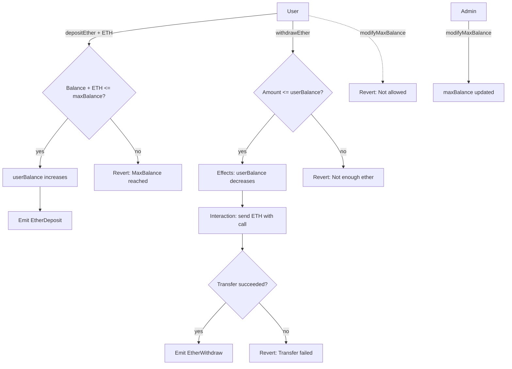

# CryptoBank

CryptoBank is a multi-user ETH vault built with Solidity 0.8.24. Each address has its own recorded balance, and users can deposit ETH and withdraw up to that balance. The administrator can change the maximum balance each user can reach through deposits.

For example, if Alice deposits 5 ETH and Bob deposits 2 ETH, the contract holds 7 ETH. Alice can withdraw up to 5 ETH and Bob up to 2 ETH. A deposit cap of 5 ETH applies separately to each account.

## Concepts practiced

- State variables and `mapping(address => uint256)` for per-user accounting
- `payable` functions and `msg.value`
- Constructor and owner-only access control with a modifier
- `require` with custom revert messages
- Events for deposits and withdrawals
- Checks-Effects-Interactions and low-level `call` to send ETH
- Manual testing in Remix, including reverts

## System flow

## How it works

| Function | Behavior |
| --- | --- |
| `depositEther()` | Credits the ETH sent with the call (`msg.value`) to the caller's existing balance. Reverts if the resulting balance exceeds `maxBalance`. |
| `withdrawEther(amount_)` | Checks the caller's recorded balance, deducts the requested amount, and sends ETH to the caller. If the transfer fails, the deduction is reverted. |
| `modifyMaxBalance(newMaxBalance_)` | Changes the cap used to validate deposits. Only the administrator can call this function. |
| `userBalance(address)` | Returns the recorded balance of an address in wei. |
| `maxBalance()` / `admin()` | Return the current cap in wei and the administrator's address. |

Successful deposits and withdrawals emit `EtherDeposit` and `EtherWithdraw`, respectively. Both events record the caller and the amount moved.

## Run locally in Remix

1. Open [Remix](https://remix.ethereum.org/) and load `CryptoBank.sol`.
2. Compile the contract with Solidity **0.8.24**.
3. Open **Deploy & Run Transactions** and select a **Remix VM** environment.
4. Deploy with `maxBalance_` set to `5000000000000000000` (5 ETH), `admin_` set to the address of your first Remix account, and **Value** set to `0`.
5. To deposit, select the sender account, enter the amount and unit in **Value**, and call `depositEther()`.
6. To withdraw or change the cap, leave **Value** at `0` and enter the requested amount in the function's input field, in wei.

**Unit reference** · 1 ETH = `1000000000000000000` wei.

## Manual test cases

Start with a fresh deployment and a cap of 5 ETH. Use account A as the administrator and account B as a second user. Run the cases in order.

| Action | Expected result |
| --- | --- |
| A deposits 3 ETH, then 2 ETH. | Both deposits succeed. `userBalance(A)` returns 5 ETH in wei. |
| A tries to deposit 1 more wei. | Reverts with `MaxBalance reached`. A's balance stays at 5 ETH. |
| B tries to withdraw 1 wei before depositing. | Reverts with `Not enough ether`. |
| B deposits 2 ETH. | A and B have 5 ETH and 2 ETH recorded, respectively. The contract now holds 7 ETH. |
| B tries to withdraw `2000000000000000001` wei. | Reverts with `Not enough ether`. B's balance stays at 2 ETH. |
| B withdraws `2000000000000000000` wei. | B's recorded balance drops to zero. A's stays at 5 ETH. |
| B tries to raise the cap to 10 ETH. | Reverts with `Not allowed`. |
| A sets the cap to `10000000000000000000` wei. | `maxBalance()` returns 10 ETH in wei. The recorded user balances stay the same. |

## Contract design

- **Per-account accounting.** The `userBalance` mapping identifies the amount each address can withdraw. Deposits accumulate under `msg.sender`.
- **Checks–Effects–Interactions.** A withdrawal checks the available balance, updates it, and then makes the external ETH transfer. If `.call` reports failure, the withdrawal reverts with `Transfer failed`.
- **Administrator permissions.** The `onlyAdmin` modifier compares `msg.sender` with the administrator set at deployment. Lowering the cap affects subsequent deposits. Users whose balances are already above the new cap can still withdraw their funds.

CryptoBank is an educational project designed for local testing. It has not been audited.

## Credits

Contract written in class for the Blockchain Accelerator course taught by José; this repository holds my copy of the exercise with added documentation.

## License

GPL-3.0, as declared in `CryptoBank.sol`.
